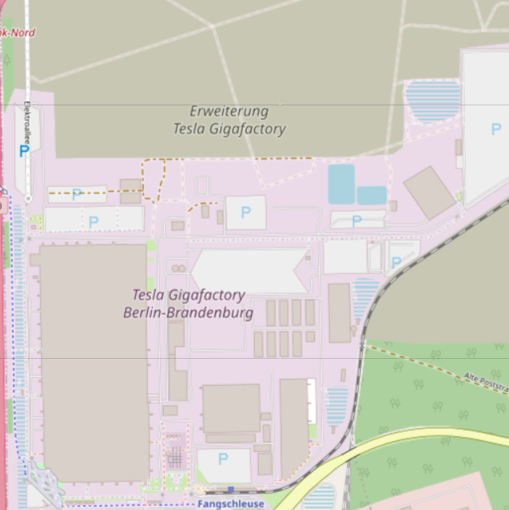
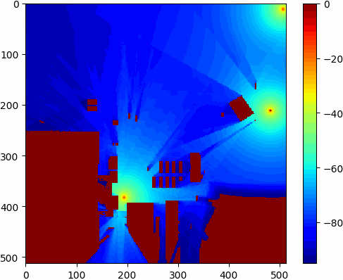
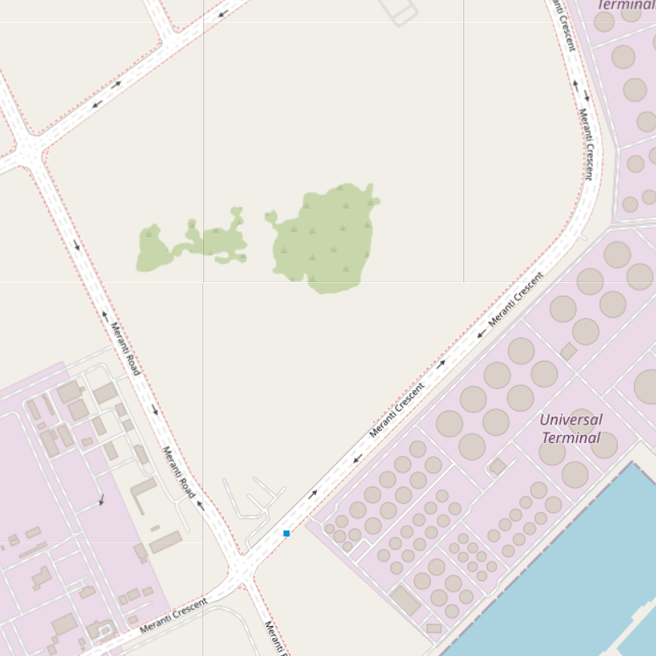
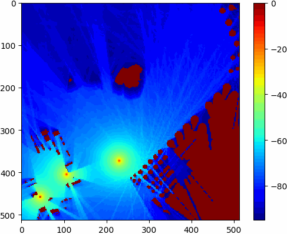
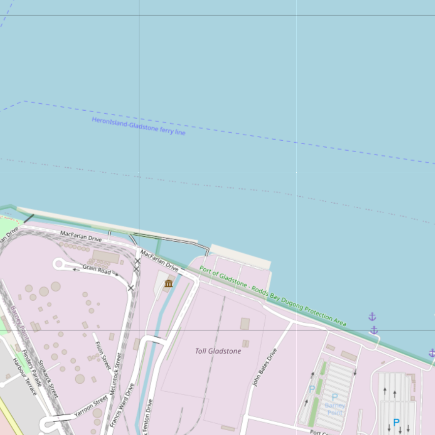
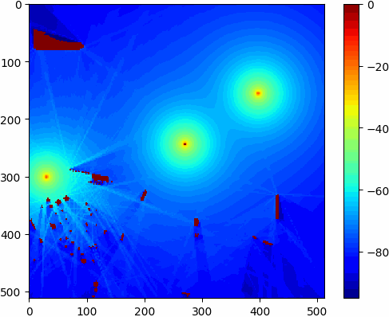

# RadioIndustryMap

**RadioIndustryMap** is a large-scale, high-fidelity, time-varying electromagnetic (EM) / radio map dataset for **Electromagnetic Map Reconstruction**, **Radio Environment Mapping (REM)**, and **6G Industrial Internet of Things (IIoT)** research.

**Dataset Download:** The dataset files are hosted on Baidu Netdisk. This repository provides dataset documentation, representative samples, and visualization examples.(The data currently available through this link represent 50% of the complete dataset. The complete RadioIndustryMap dataset, benchmark splits, detailed metadata, paper information, and citation will be publicly released after the corresponding paper is accepted.)

> **Baidu Netdisk:**   https://pan.baidu.com/s/1nmZkMQd0dkofBj4MvMX3dQ?pwd=ucg8
---

## 1. Dataset Description

Unlike conventional radio map datasets that mainly focus on  transmitters in simplified urban environments, RadioIndustryMap targets realistic industrial and offshore scenarios with **mobile transmitters**, **dynamic radio propagation**, **heterogeneous material compositions**, and **complex industrial geometries**. It explicitly models representative industrial materials and objects, including metal structures, concrete buildings, vegetation, road surfaces, water surfaces, industrial facilities, containers, pipelines, storage tanks, and moving vessels.

RadioIndustryMap is needed because existing radio map datasets mainly focus on static, concrete-dominated urban environments and cannot fully capture the complex propagation mechanisms of industrial 6G IIoT scenarios. In realistic industrial and offshore deployments, heterogeneous materials, dense metallic infrastructures, water surfaces, mobile transmitters, and dynamic scatterers jointly introduce severe multipath, material-dependent reflection and attenuation, dynamic blockage, and time-varying spatial correlations. RadioIndustryMap is therefore designed to provide physically realistic, time-varying, and material-aware radio maps for robust learning-based reconstruction and radio environment mapping.

---

## 2. Dataset Information

The complete release of RadioIndustryMap is expected to include:

| Item               | Description                                                  |
| ------------------ | ------------------------------------------------------------ |
| Number of scenes   | Approximately 800 scenes                                     |
| Number of samples  | Approximately 400,000 radio map samples                      |
| Scenario types     | Automated chemical plants, smart container ports, offshore industrial zones |
| Frequency bands    | 500 MHz, 700 MHz, 900 MHz, 1500 MHz, 2100 MHz, 3500 MHz, 4900 MHz, 5800 MHz |
| Receiver heights   | 1.5 m, 5 m, 10 m, 20 m, 60 m                                 |
| Temporal frames    | 50 frames per dynamic sequence                               |
| Time interval      | 2 seconds                                                    |
| Grid size          | 512 × 512                                                    |
| Spatial resolution | 3 m per grid cell                                            |
| Physical coverage  | 1536 m × 1536 m per radio map                                |

Each radio map sample corresponds to a specific scenario, carrier frequency, receiver height, and temporal frame. For dynamic scenarios, transmitter trajectories are sampled every 2 seconds, and each sequence contains 50 consecutive temporal frames.

### Dataset Preview

The following table shows representative examples from three scenario types. Each row contains a geographic map in `.png` format and the corresponding 50-time-slot dynamic radio map sequence in `.gif` format.

<table>
     <colgroup>
    <col style="width:42%;">
    <col style="width:58%;">
  </colgroup>
  <tr>
    <th align="center">Geographic Map (.png)</th>
    <th align="center">50-Time-Slot Radio Map Sequence (.gif)</th>
  </tr>
  <tr>
    <td align="center">
      <b>Automated Chemical Plant</b> 
      
    </td>
    <td align="center">
      <b>Automated Chemical Plant</b> 
      
    </td>
  </tr>
  <tr>
    <td align="center">
      <b>Smart Container Port</b> 
      
    </td>
    <td align="center">
      <b>Smart Container Port</b> 
      
    </td>
  </tr>
  <tr>
    <td align="center">
      <b>Offshore Industrial Zone</b> 
      
    </td>
    <td align="center">
      <b>Offshore Industrial Zone</b> 
      
    </td>
  </tr>
</table>

---

## 3. Folders in the Repository

`RadioIndustryMap/<Scenario>/<Frequency>/npy/`: Raw radio map matrices in `.npy` format for model training and evaluation. Each file is named as `mapx_receiverm_frequencyf_t=y.npy`, where `mapx` denotes the scenario or map index, `receiverm` denotes the receiver height, and `frequencyf` denotes the frequency, `t=y` denotes the temporal frame index. Example files include `map1_receiver1.5m_frequency500Mhz_t=1.npy` and `map1_receiverm1.5m_frequency500Mhz_t=50.npy`.

`RadioIndustryMap/<Scenario>/<Frequency>/png/`: Visualization images of the corresponding radio maps in `.png` format. Each file follows the same naming rule as the matrix files, such as `map1_receiver1.5m_frequency500Mhz_t=1.png`.

`RadioIndustryMap/<Scenario>/<Frequency>/gif/`: Animated visualizations of continuous time-varying radio map sequences in `.gif` format. Each file is named as `mapx_receiverm_frequencyf.gif`, such as `map1_receiver1.5m_frequency500Mhz.gif`.

`Global_Index/Building/`: Building spatial distribution information for the corresponding scenes. This folder includes building distribution matrices and `Building.zip`.

`Global_Index/Vegetation/`: Vegetation spatial distribution information, including vegetation distribution matrices and `vegetation.zip`.

`Global_Index/Trajectory/`: Road topology and transmitter trajectory-related information. This folder includes trajectory matrices and metadata files such as `trajectory_metadata.json`.

`Global_Index/Material/`: Material distribution maps and material labels for industrial objects. This folder includes files such as `map1_material.npy` and `material_labels.json`.

`Global_Index/Geography/`: Geographic information, including OpenStreetMap-related data and longitude-latitude mapping files. This folder includes `Open_Street_Map/way.zip` and coordinate files such as `map1_coordinates.npy`.

`assets/`: Visualization figures used in this README, including geographic maps, radio map examples, and dynamic radio map animations.

---

## 4. License

The license information will be updated before the public release of the full dataset.

The currently released sample data are provided for academic demonstration and preliminary research only. Some geographic information may be derived from OpenStreetMap-related data. Please follow the corresponding OpenStreetMap data usage and attribution requirements when using such information.

---

## 5. Contact

If you have any questions about RadioIndustryMap, please open an issue in this repository or contact the project team.
